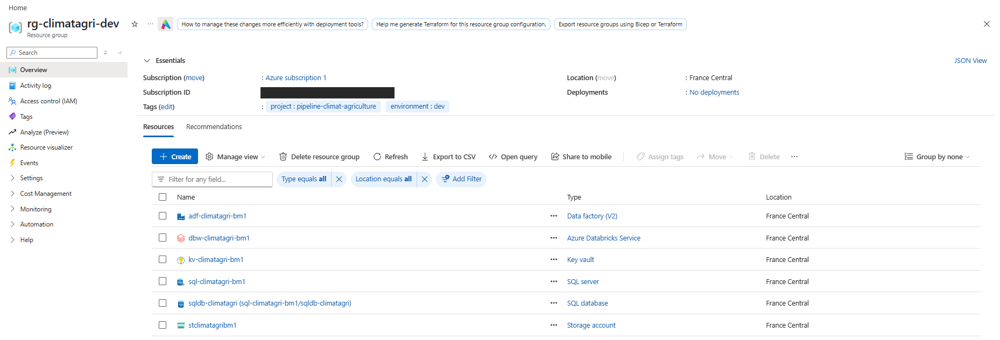
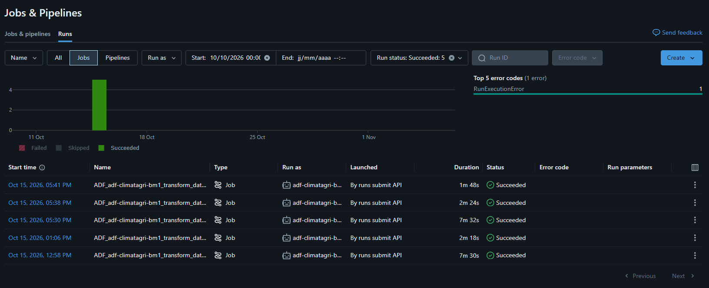
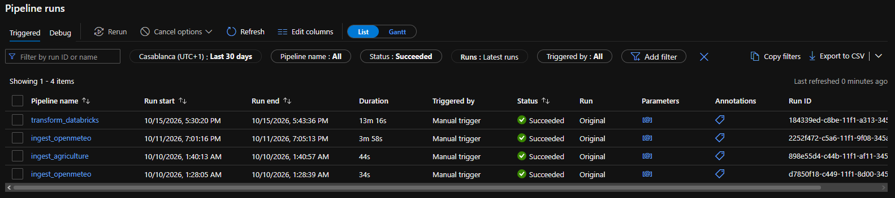
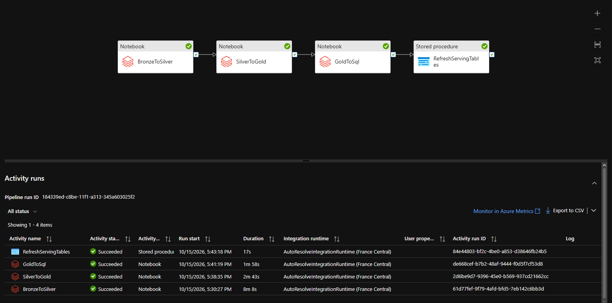
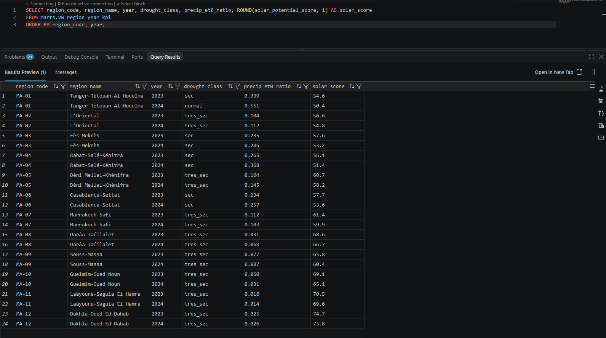
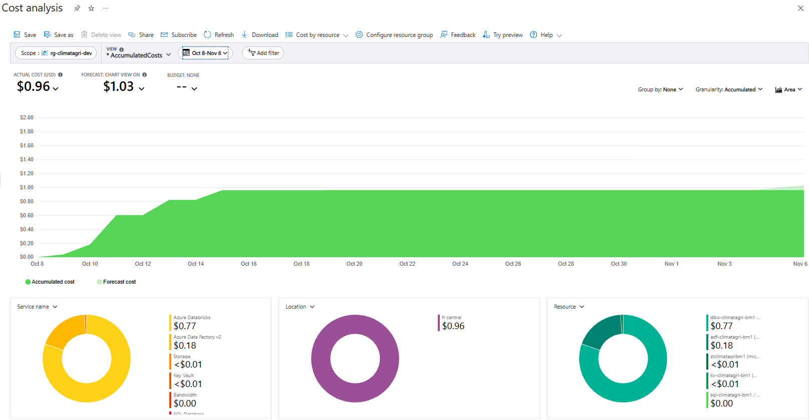

# Déploiement Azure réel — journal

Journal du déploiement effectif de l'extension Azure ([azure/README.md](../azure/README.md)).
Ce document ne rapporte que ce qui a été **exécuté et observé** ; les décisions en attente
sont marquées comme telles. Les coûts réels figurent dans « Coût réel observé ».

**Statut au 2026-11-06 : chaîne medallion validée de bout en bout sur Azure. Ingestion ADF
(12 régions × 2023-2024) → notebooks Databricks 01, 02 et 03 pilotés par le pipeline ADF
`transform_databricks` (run du 2026-10-15, `Succeeded`, 13 min 16 s) → Azure SQL
(`marts.vw_region_year_kpi`, 24 lignes). Reste hors périmètre : Power BI, déclencheurs
quotidiens, et le démontage (`teardown.sh`), à faire manuellement.**

*Les six ressources déployées dans `rg-climatagri-dev` (l'ID d'abonnement est masqué).*

## Contexte

- Abonnement : Azure free account (crédit d'essai). Budget Cost Management de 50 €/mois avec
  alertes (réel 10 % et 40 %, réel 100 %, prévision 100 %). Les alertes **préviennent
  seulement** : elles n'arrêtent aucune ressource, la protection réelle est `teardown.sh`.
- Région : `francecentral`. Groupe de ressources : `rg-climatagri-dev`.
- Les commandes `az` sont lancées à la main, une ressource à la fois, avec validation de la
  sortie avant la suivante. `deploy.sh` n'a pas été utilisé tel quel (voir « Écarts »).
  La partie Data Factory passe par `azure/scripts/deploy_adf_ingest.sh`.

## Ce qui est déployé

| Ressource | État | Remarque |
|---|---|---|
| Resource group `rg-climatagri-dev` | créé | gratuit |
| Storage ADLS Gen2 `stclimatagri<suffix>` | créé | LRS, espace de noms hiérarchique, accès public aux blobs désactivé, conteneurs `bronze`, `silver`, `gold` |
| Key Vault `kv-climatagri-<suffix>` | créé | modèle **Vault access policy** (basculé depuis RBAC : voir « Databricks »), suppression logique ; secrets `sql-user`, `sql-password` (mot de passe généré, jamais affiché ni écrit dans un fichier) et `storage-account-key` |
| Azure SQL (serveur + base `sqldb-climatagri`) | créé | General Purpose serverless, offre « free database » avec `AutoPause` ; authentification SQL conservée, admin Entra ajouté ; règles de pare-feu `AllowAzureServices` et `AllowMyIP` (temporaire) |
| Data Factory `adf-climatagri-<suffix>` | créé | identité managée système, rôle *Storage Blob Data Contributor* sur le Storage |
| Ressources ADF (ingestion) | déployées | 3 services liés, 5 datasets, 2 pipelines, 2 triggers **arrêtés** |
| Ressources `dbg_*` | supprimées | sondes de diagnostic (écho REST et HTTP), retirées après le diagnostic ; dossier `bronze/_debug/` supprimé |
| Databricks workspace (Premium) | créé | cluster interactif `gate-single-node` démarré avec succès sur le Free Trial ; scope secret adossé au Key Vault ; notebooks importés dans `/Shared/pipeline-climat-agriculture` |
| `transform_databricks`, `ls_databricks`, `ls_azuresql` | déployés dans ADF | run manuel réussi le 2026-10-15 (voir « Run ADF final »). Le déclencheur quotidien de ce pipeline n'a pas été relevé ici : la courbe de coût plate depuis le 16 oct. indique qu'il n'a pas tourné |
| DDL Azure SQL (`marts`, étoile, vue `vw_region_year_kpi`) | joué | la vue renvoie les 24 lignes attendues (voir « Run ADF final ») |

## Quotas observés

- Fournisseurs nécessaires : `Microsoft.Storage`, `Sql`, `DataFactory`, `Databricks`, `KeyVault`
  déjà enregistrés. `Microsoft.Compute` et `Microsoft.Network` ne l'étaient pas et ont dû être
  enregistrés (gratuit).
- Piège rencontré : tant que `Microsoft.Compute` n'est pas enregistré, `az vm list-usage`
  renvoie une liste **vide** (sans erreur), ce qui ressemble à « aucun quota ».
- Après enregistrement, en `francecentral` : 4 vCPU au total par région, et 4 vCPU pour
  chacune des familles `Standard DSv2`, `DSv3` et `BS`.
- Conséquence : le total régional est partagé par toutes les VM. Un cluster de 4 vCPU en
  fonctionnement empêche de démarrer une autre VM en même temps.

## Azure SQL : offre gratuite

- L'offre « free database » (`--use-free-limit`) est limitée à une base par abonnement.
- Avec `AutoPause` à l'épuisement, **seule la valeur par défaut** du délai de pause est
  acceptée (60 min) : `--auto-pause-delay 15` est refusé (`ProvisioningDisabled`), sans base
  partielle créée.
- Conséquence : à l'épuisement du quota mensuel, la base reste en pause jusqu'au mois suivant,
  mais ne peut pas être facturée.

## Ingestion Open-Meteo : ce qui s'est passé

| Essai | Résultat |
|---|---|
| `RestSource`, en-têtes par défaut | échec côté source après ~11 min (2 retries de 5 min) : `InvalidDataException: Found invalid data while decoding` |
| `RestSource` + `Accept-Encoding: gzip, deflate;q=0` | même échec (~12 min) |
| Sonde REST contre un service d'écho | ADF envoie `Accept-Encoding: gzip, deflate` : **`additionalHeaders` est ignoré** par le connecteur REST |
| Sonde HTTP en mode `Binary` | `additionalHeaders` **honoré** ; octets du serveur écrits sans modification (gzip brut) ; contenu décompressé = JSON valide, `daily.time` sur 7 dates |

Constat serveur (`curl`) : Open-Meteo répond en `deflate` zlib à `gzip, deflate`, en `gzip` si
`deflate` est refusé, en JSON clair avec `identity`.

Décision : connecteur HTTP en mode `Binary` avec `Accept-Encoding: identity`. **À valider** par
un run complet sur une région. Cause du décodage : hypothèse (décodeur `deflate` du connecteur
REST) non démontrée, contournée.

Leçon : un run en échec déterministe coûte ~11 min à cause des retries (2 × 5 min) ; une sonde
`retry: 0` avec un service d'écho est bien plus rapide pour comprendre ce qu'ADF envoie.

## Databricks

**Résultat : un cluster single-node démarre sur le Free Trial.**

- Cluster interactif `gate-single-node` : single node, `Standard_E4ads_v7` (4 vCPU, 32 Go),
  runtime 17.3 LTS (Spark 4.0), Photon désactivé, arrêt automatique à 10 min, 2,06 DBU/h
  affichés. `Standard_DS3_v2` (prévu par `ls_databricks.json`) n'a **jamais été testé**.
- Le quota de 4 vCPU par région est partagé par toutes les VM : un seul cluster à la fois.
- Passer en Pay-as-you-go est **exclu** : il supprime la limite de dépense.

Authentification à ADLS depuis les notebooks (méthode retenue : la plus simple) :

- Les notebooks ne configurent aucun identifiant : la clé du compte de stockage est lue dans
  le Key Vault via un scope secret, et injectée par la configuration Spark du cluster :
  `spark.hadoop.fs.azure.account.key.<compte>.dfs.core.windows.net {{secrets/kv-climat-agriculture/storage-account-key}}`.
- **Les scopes adossés à Key Vault ne supportent que le modèle « Vault access policy »**, pas
  le RBAC (documentation Azure Databricks). Le coffre, créé en RBAC, a dû être basculé, puis une
  politique d'accès a été ajoutée pour l'opérateur. Le nom du scope (`kv-climat-agriculture`)
  est celui que `transform_databricks` attend par défaut.
- La clé de compte donne un accès complet au Storage : acceptable pour cette démonstration
  (groupe de ressources supprimé à la fin), à remplacer par un service principal, un SAS ou
  Unity Catalog en production.
- `spark.sql.ansi.enabled false` est posé sur le cluster : Spark 4 active ANSI par défaut, alors
  que les notebooks ont été écrits pour la sémantique Spark 3 (un `cast` invalide donne `NULL`).

État des notebooks : `01_bronze_to_silver`, `02_silver_to_gold` et `03_gold_to_sql` ont été
exécutés avec succès. Les deux premiers ont d'abord été validés à la main sur le cluster
interactif (données de test : 1 région, 7 jours), puis les trois ont tourné via ADF sur les
12 régions × 2023-2024 (voir « Run ADF final »). `03_gold_to_sql` a été exécuté après le
passage du DDL Azure SQL.

`ls_databricks.json` a été aligné sur le cluster validé (`Standard_E4ads_v7`, runtime 17.3 LTS,
`spark.sql.ansi.enabled false`, clé de compte lue dans le scope Key Vault). Le **job cluster
créé par ADF** accepte la clé de compte : les trois notebooks ont lu et écrit dans ADLS sans
repli sur `existingClusterId`. Dans Databricks, les jobs apparaissent « Launched by runs submit
API », exécutés par l'identité managée de la Data Factory.

*Databricks, Jobs & Pipelines : 5 jobs `Succeeded` lancés par ADF le 15 oct. (3 pour le run final de 17 h 30, 2 lancés plus tôt le même jour, à 12 h 58 et 13 h 06). Le compteur d'erreurs de la période affiche aussi 1 `RunExecutionError`, dont la cause n'est pas documentée ici.*

## Résultats observés : bronze → silver → gold

Run `ingest_openmeteo` sur les 12 régions, 2023-01-01 → 2024-12-31 (1 requête par région) :
`Succeeded`, 12 blobs de 38,2 à 38,7 Ko. L'ancienne partition MA-04 (7 jours) a été conservée :
le silver garde la dernière ingestion par (région, jour).

Notebooks `01_bronze_to_silver` puis `02_silver_to_gold` exécutés sur le cluster interactif :

- `gold/fct_region_climate_kpi` et `gold/fct_solar_potential` : 24 lignes chacun
  (12 régions × 2 ans), `is_complete_year = true` et couvertures à 1,0 partout.
- `precip_et0_ratio` observé de 0,014 (MA-11) à 0,551 (MA-01) ; `solar_potential_score` de 50,4
  (MA-01) à 74,7 (MA-12), avec un gradient nord-sud.
- `has_agriculture_data` vrai en 2023 et faux en 2024 (la fixture s'arrête en 2023) ;
  `spi_simplified` NULL partout (moins de 5 années complètes).

### Parité avec le pipeline local (dbt / Postgres) : `fct_region_climate_kpi`, 2023-2024

Comparaison ligne à ligne réalisée par l'opérateur : mêmes 12 régions, mêmes années, mêmes
données Open-Meteo. Résultats **rapportés** (le tableau Databricks n'est pas archivé ici) :

- 24 paires (région, année) comparées sur `precipitation_total_mm`, `et0_total_mm`,
  `precip_et0_ratio` et `drought_class`.
- `precip_et0_ratio` (3 décimales) et `drought_class` : identiques sur les 24 lignes.
- `et0_total_mm` (1 décimale) : écart de 0,1 mm sur 2 lignes (MA-07 et MA-11, 2023 :
  1732,9 contre 1732,8 et 1970,4 contre 1970,3), soit 0,006 % en relatif. Cause **probable**,
  non vérifiée : arrondi d'une égalité exacte (`numeric` Postgres contre `double` Spark) sur un
  cumul de 731 valeurs à 2 décimales.
- Non comparé : les colonnes agricoles et `fct_solar_potential`.

Table locale de référence (précipitations et ET0 en mm, ratio P/ET0) ; elle est cohérente en
interne (ratio = P/ET0 et classes conformes aux seuils 0,20 / 0,50 / 0,65) :

| Région | 2023 : P / ET0 / ratio / classe | 2024 : P / ET0 / ratio / classe |
|---|---|---|
| MA-01 | 460,3 / 1358,4 / 0,339 / sec | 718,9 / 1304,5 / 0,551 / normal |
| MA-02 | 171,2 / 1647,1 / 0,104 / tres_sec | 189,0 / 1681,6 / 0,112 / tres_sec |
| MA-03 | 382,7 / 1627,6 / 0,235 / sec | 445,7 / 1556,6 / 0,286 / sec |
| MA-04 | 332,7 / 1257,0 / 0,265 / sec | 459,0 / 1247,8 / 0,368 / sec |
| MA-05 | 276,5 / 1685,5 / 0,164 / tres_sec | 237,7 / 1636,4 / 0,145 / tres_sec |
| MA-06 | 299,2 / 1280,0 / 0,234 / sec | 330,5 / 1285,2 / 0,257 / sec |
| MA-07 | 194,4 / 1732,9 / 0,112 / tres_sec | 175,7 / 1701,2 / 0,103 / tres_sec |
| MA-08 | 57,7 / 1871,9 / 0,031 / tres_sec | 124,6 / 1823,2 / 0,068 / tres_sec |
| MA-09 | 127,9 / 1653,8 / 0,077 / tres_sec | 134,6 / 1550,3 / 0,087 / tres_sec |
| MA-10 | 119,0 / 1978,1 / 0,060 / tres_sec | 57,7 / 1872,5 / 0,031 / tres_sec |
| MA-11 | 30,7 / 1970,4 / 0,016 / tres_sec | 28,1 / 1964,7 / 0,014 / tres_sec |
| MA-12 | 33,8 / 1354,0 / 0,025 / tres_sec | 33,9 / 1311,9 / 0,026 / tres_sec |

## Run ADF final : `transform_databricks`

| Champ | Valeur |
|---|---|
| Pipeline | `transform_databricks` (déclenchement manuel) |
| Run ID | `184339ed-c8be-11f1-a313-345a603025f2` |
| Début → fin | 2026-10-15 17:30:20 → 17:43:36 (heure affichée par le moniteur ADF, filtre Casablanca UTC+1) |
| Durée | **13 min 16 s** |
| Statut | **Succeeded** |

| Activité | Type | Début | Durée | Statut |
|---|---|---|---|---|
| `BronzeToSilver` | Notebook (01) | 17:30:27 | 8 min 8 s | Succeeded |
| `SilverToGold` | Notebook (02) | 17:38:35 | 2 min 43 s | Succeeded |
| `GoldToSql` | Notebook (03) | 17:41:19 | 1 min 58 s | Succeeded |
| `RefreshServingTables` | Procédure stockée | 17:43:18 | 17 s | Succeeded |

Les durées ADF sont un peu supérieures à celles des jobs Databricks (7 min 32 s, 2 min 24 s,
1 min 48 s) : elles incluent l'attente et le démarrage du job cluster. Les quatre activités
s'enchaînent sur l'`AutoResolveIntegrationRuntime` (France Central).

*Moniteur ADF (statut `Succeeded`) : `transform_databricks` (13 min 16 s), `ingest_openmeteo` sur 12 régions (3 min 58 s, 2026-10-11), `ingest_agriculture` (44 s) et le premier run `ingest_openmeteo` de validation (34 s).*

*Les quatre activités du run final : trois notebooks Databricks puis la procédure stockée.*

Restitution côté Azure SQL : la vue `marts.vw_region_year_kpi` renvoie **24 lignes** (12 régions
× 2023-2024). Relevé visuel sur la capture : `precip_et0_ratio` et `drought_class` sont
identiques, ligne à ligne, à la table locale de référence ci-dessus ; `solar_score` va de 50,4
(MA-01, 2024) à 74,7 (MA-12, 2023), comme dans le gold Databricks. La parité des colonnes
agricoles et de `fct_solar_potential` n'a pas été comparée (voir plus haut).

*Requête sur la vue de serving, exécutée depuis VS Code.*

## Problèmes résolus

| Problème | Cause | Résolution |
|---|---|---|
| Ingestion REST en échec (`InvalidDataException: Found invalid data while decoding`, ~11-12 min par essai à cause des retries) | ADF envoie `Accept-Encoding: gzip, deflate` et **ignore** `additionalHeaders` avec le connecteur REST (démontré par sonde). Cause du décodage : décodeur `deflate`, **hypothèse non démontrée** | Connecteur HTTP en mode `Binary` avec `Accept-Encoding: identity`. Validé : 12 régions × 2023-2024 en 3 min 58 s |
| `--auto-pause-delay 15` refusé sur Azure SQL (`ProvisioningDisabled`) | Avec l'offre gratuite et `AutoPause` à l'épuisement, seule la valeur par défaut (60 min) est acceptée | Valeur par défaut conservée ; aucune base partielle créée |
| `az vm list-usage` renvoyait une liste vide | `Microsoft.Compute` et `Microsoft.Network` non enregistrés | Fournisseurs enregistrés (gratuit) ; quotas réels relevés (4 vCPU par région) |
| Scope secret Databricks inutilisable avec le Key Vault | Les scopes adossés à Key Vault ne supportent pas le modèle RBAC | Key Vault basculé en « Vault access policy » |
| Droits de plan de données manquants | Propriétaire de l'abonnement sans droits sur les secrets ni sur les blobs | *Key Vault Secrets Officer* et *Storage Blob Data Contributor* attribués à la main |
| Résultats Spark différents de ceux attendus | Spark 4 active ANSI par défaut ; les notebooks supposent la sémantique Spark 3 (`cast` invalide → `NULL`) | `spark.sql.ansi.enabled false` sur le cluster et dans `ls_databricks.json` |
| `ls_databricks.json` incompatible avec le cluster validé | Valeurs d'origine non testées (`Standard_DS3_v2`, runtime 15.4) | Aligné sur `Standard_E4ads_v7`, 17.3 LTS, clé de compte via le scope ; validé par le run final |
| DDL impossible depuis le poste, `CREATE USER … FROM EXTERNAL PROVIDER` bloqué | Pare-feu SQL sans l'IP de l'opérateur ; aucun admin Entra sur le serveur | Règle `AllowMyIP` temporaire et admin Entra ajoutés |

Non documenté : la cause du `RunExecutionError` visible dans l'historique Databricks et des
jobs lancés à 12 h 58 et 13 h 06 le 15 oct. (avant le run final). À compléter si besoin.

## Écarts constatés dans `azure/scripts/deploy.sh`

Constatés à la relecture, à corriger sur la branche `feat/azure-deploy` :

1. Key Vault en autorisation RBAC : le propriétaire de l'abonnement n'a pas les droits sur les
   secrets. Il faut d'abord s'attribuer *Key Vault Secrets Officer*. *(Contourné à la main.)*
2. Même chose pour le stockage : *Storage Blob Data Contributor* est nécessaire pour créer les
   conteneurs et téléverser avec `--auth-mode login`. *(Contourné à la main.)*
3. Aucun administrateur Entra n'est défini sur le serveur SQL, ce qui bloque
   `CREATE USER … FROM EXTERNAL PROVIDER` pour l'identité managée d'ADF. *(Admin ajouté ;
   l'utilisateur ADF existe désormais : la procédure stockée `RefreshServingTables`, appelée via
   `ls_azuresql` en identité managée, a réussi.)*
4. Le pare-feu SQL n'autorise pas l'IP de l'opérateur, donc pas de DDL depuis le poste.
   *(Règle temporaire ajoutée.)*
5. Le mot de passe SQL passe en argument de ligne de commande. *(Généré dans une variable du
   shell et stocké dans Key Vault ; il transite brièvement dans les arguments du processus `az`.)*
6. Le nom `kv-climat-agriculture` (paramètre de `transform_databricks`) diffère du nom du
   Key Vault créé par le script. *(Résolu : c'est le nom du scope Databricks, créé tel quel.)*
7. Databricks Premium et Unity Catalog configurés à la main : à simplifier. *(Simplifié : clé de
   compte via scope Key Vault, sans Unity Catalog.)*
8. Le déploiement ADF envoie tous les dossiers : sans Databricks, `ls_databricks`,
   `transform_databricks` et `tr_daily_transform` doivent être exclus. *(Traité par
   `deploy_adf_ingest.sh`.)*
9. L'ingestion REST échoue (voir ci-dessus) : remplacée par le connecteur HTTP en mode binaire.
10. `deploy.sh` crée le Key Vault en RBAC, incompatible avec un scope secret Databricks adossé à
    Key Vault : à créer en « Vault access policy » ou à utiliser un scope Databricks-backed.
11. `ls_databricks.json` cible `Standard_DS3_v2` et le runtime 15.4, alors que le cluster validé
    est `Standard_E4ads_v7` en 17.3 LTS. *(Corrigé : aligné et validé par le run final.)*

## Défaut de conception connu : partitions bronze sans plage de dates

Le sink `ds_bronze_openmeteo_json` écrit à
`openmeteo/ingest_date=<jour>/region_code=<code>/data.json`. Le chemin ne contient **pas** la
plage `startDate`–`endDate` : deux runs le **même jour** sur des plages différentes écrasent le
fichier de chaque région. Le conseil du README des pipelines (backfill par tranches de 2 ans)
ne fonctionnerait donc pas en un seul jour : seule la dernière tranche serait conservée.

Contournement actuel : un seul run par jour, avec une plage couvrant tout le besoin (2023-01-01 →
2024-12-31 pour l'enrichissement de démonstration, 2 ans par requête comme le client local).

Correction envisagée, **non faite** : inclure `startDate` dans le nom de fichier ou le dossier
et adapter le motif de lecture du notebook 01 (`data.json` → `data*.json`).

Autre limite connue : la fixture agricole couvre 2015-2023, la météo ingérée 2023-2024 : les
colonnes agricoles de 2024 sont NULL (jointure à gauche), et `spi_simplified` reste NULL tant
qu'il y a moins de 5 années complètes de référence.

## Coût réel observé

Relevé dans Cost Management (*Cost analysis*), scope `rg-climatagri-dev`, période du 8 oct. au
6 nov. 2026, **en dollars US** (les estimations ci-dessous sont en euros par mois) :

| Service | Estimé | Observé (8 oct. → 6 nov.) |
|---|---|---|
| Azure Databricks | à estimer avant création | **0,77 $** |
| Azure Data Factory v2 | 1 à 8 €/mois | **0,18 $** (période incluant les runs REST en échec de 11-12 min et les sondes `dbg_*`) |
| Storage | < 1 €/mois | < 0,01 $ |
| Key Vault | < 1 €/mois | < 0,01 $ |
| Azure SQL (offre gratuite) | 0 à 12 €/mois | 0,00 $ |
| Bande passante | n/a | 0,00 $ |
| **Total** | | **0,96 $** (prévision Cost Management : 1,03 $) |

*Cost Management, `rg-climatagri-dev`, 8 oct. → 6 nov. 2026 : 0,96 $ cumulés.*

À lire avec ces réserves :

- La courbe cumulée est **plate depuis environ le 16 oct.** : les ressources laissées en place
  (Storage, Key Vault, SQL gratuit, cluster arrêté automatiquement) ne coûtent pas visiblement.
  Les données Cost Management ont un décalage de 24 à 48 h, donc les derniers jours peuvent
  être incomplets.
- Le scope est le groupe de ressources. Les machines virtuelles du cluster Databricks sont
  habituellement facturées dans le groupe de ressources **géré** par Databricks
  (`databricks-rg-*`), hors de ce scope. **Non vérifié** : le total de 0,96 $ peut donc sous-estimer
  le coût réel. À contrôler au niveau de l'abonnement avant de citer un coût total.
- Les calculs ont tourné sur un abonnement d'essai (crédit gratuit) ; ce chiffre est le coût
  affiché, pas forcément un montant débité.

## Nettoyage

Aucune ressource Azure n'a été supprimée : **tout est encore déployé** (groupe
`rg-climatagri-dev`, six ressources). Le démontage est à faire manuellement.

Fin de démonstration : `azure/scripts/teardown.sh --apply` supprime le groupe de ressources.
Le Key Vault est supprimé de façon logique : son nom reste réservé tant qu'il n'est pas purgé
(`az keyvault purge`). Avant cela : supprimer la règle de pare-feu `AllowMyIP` si le groupe de
ressources est conservé, et terminer le cluster Databricks s'il est actif.
